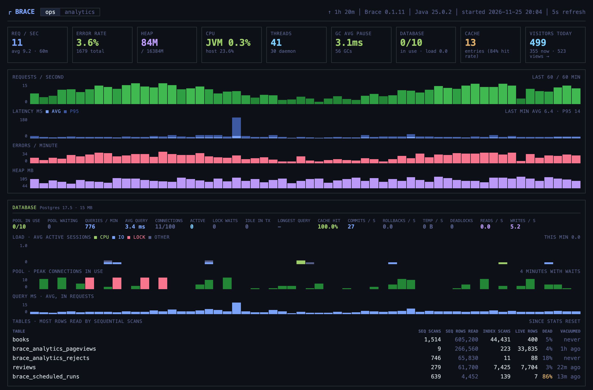
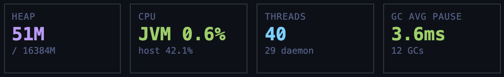
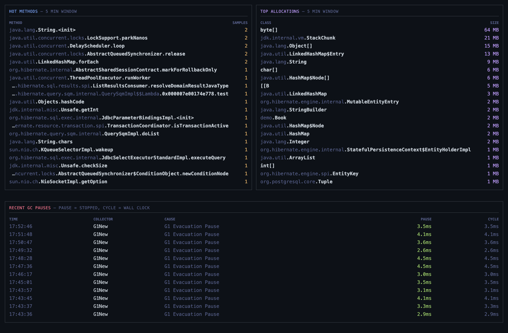
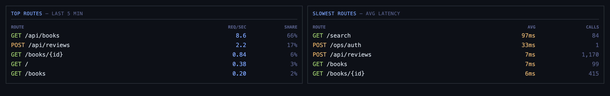
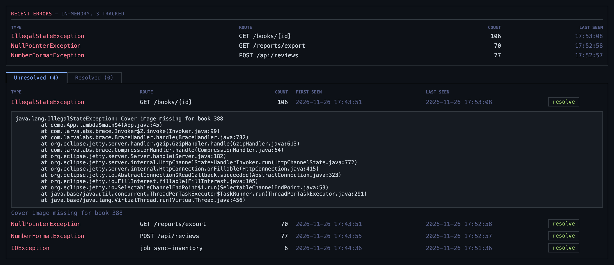
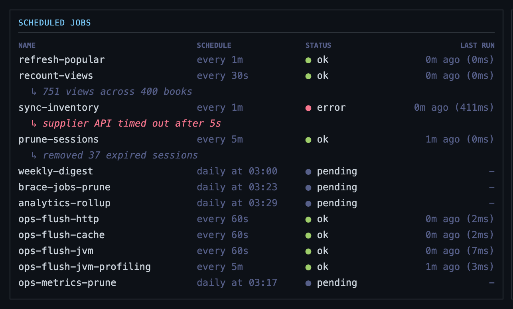
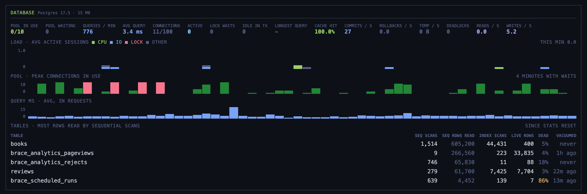
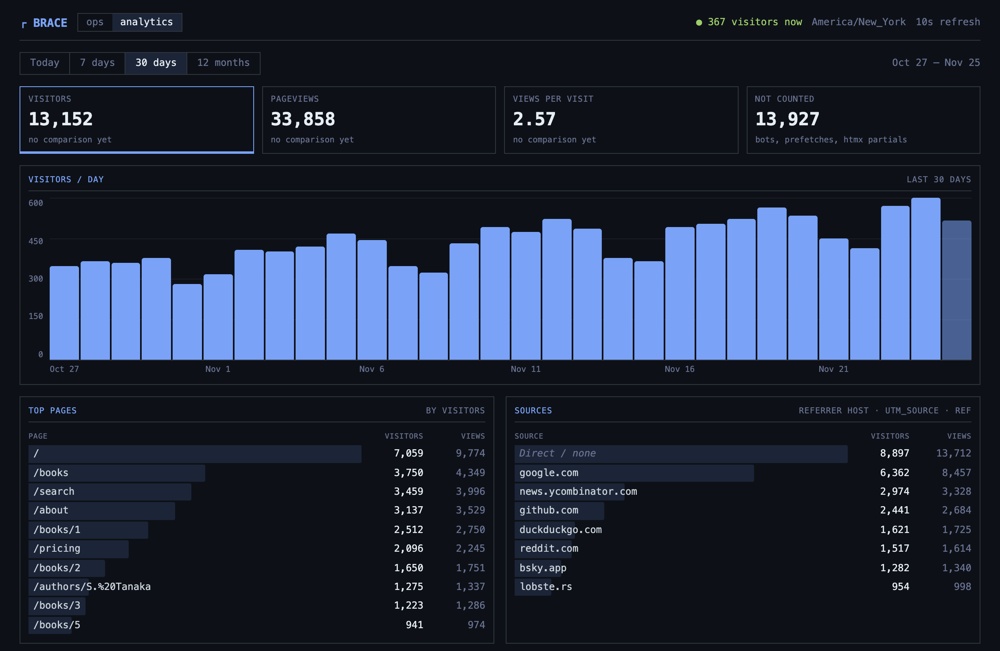

# Brace

Brace is an opinionated full-stack web framework for Java. Included are an HTTP server, database
access and migrations, typed templates, sessions, forms, background jobs, email, object storage,
analytics and an operations dashboard. Everything is written in plain Java in `main()`, no dependency injection
or magic runtimes. This provides excellent startup times, runtime performance and allows the compiler to verify correctness.
Brace requires Java 21+ and Postgres, and is optimized for Java 25+ and Postgres 16+.



## Explicit Code the Compiler Can Check

Brace has no dependency injection container, no classpath scanning and no bytecode enhancement.
Routes, middleware, entities and jobs are registered in `main()`, so one file shows how the app is
put together. Services get their dependencies through their constructors. A handler receives the
request, the database and the session as method parameters, so its signature lists everything it
can use.

Most mistakes show up as compile errors. Handlers are typed functional interfaces, forms and query
strings bind to Java records, and JTE templates declare typed parameters. A wrong parameter name or
type fails the build instead of a request.

Brace checks the rest when the app starts. `start()` refuses to run if a route has neither an
access rule nor `.publicRoute()`, if a static file mapping doesn't say who may fetch it, or if a
route that uses the session turns off CSRF without giving a reason. The error lists every route
that needs fixing.

## Features

Everything below is in the framework jar.

| Feature | What you get |
|---|---|
| HTTP server | Jetty 12 on virtual threads, gzip on by default, `/__brace/health` for load balancers |
| Routing | Routes, groups and middleware registered in `main()`, named routes with `Url.to(...)` |
| Access control | Every route declares an access rule or `.publicRoute()`, checked at startup |
| Database | Hibernate 7 StatelessSession, per-request transactions, Flyway migrations, pagination, Postgres driver included |
| Templates | JTE with typed parameters, compiled ahead of time for production |
| Forms | Request parameters or JSON bound to records, with validation annotations |
| Sessions | AES-256-GCM encrypted cookies with a fixed lifetime and rotation at login |
| CSRF | On by default for POST, PUT, PATCH and DELETE, with htmx support |
| Security | `SecurityHeaders.strict()` with a no-inline-script CSP, trusted proxy ranges, bcrypt |
| Static files | Fingerprinted asset URLs, Range requests, an access rule per mapping |
| Cache | In-process cache and page caching, or a shared Postgres backend for several servers |
| Jobs | Recurring jobs, plus a durable database-backed queue with retries that survives restarts |
| Email | SMTP mailer using JTE templates, which captures mail instead of sending it in dev mode |
| Object storage | S3, R2 and MinIO through built-in Sig V4 signing, with no AWS SDK |
| File uploads | Size limits, large parts streamed to disk, sandboxed serving of user files |
| HTTP client | `java.net.http` client with JSON, multipart, SSE parsing and SSRF protection |
| WebSocket | Rooms and broadcast, with the same access rules as HTTP routes |
| Server-Sent Events | `Result.sse(...)` with heartbeats, and no database connection held open |
| Rate limiting | Per-IP or per-key limits with bounded memory |
| htmx | htmx 2.0.10 bundled, `req.isHtmx()`, automatic `Vary: HX-Request` |
| Metrics | Counters, gauges and timers shown as dashboard sparklines |
| Analytics | Server-side page-view counts with no script, no cookies and no stored IPs |
| Ops dashboard | Requests, latency, errors, JVM, jobs, cache and Postgres load at `/ops/dashboard` |
| Error tracking | Stored exceptions with request details and the queries that ran, plus alerts for new errors |
| Ops API | JSON endpoints under `/ops/*`, authenticated with Ed25519 keys |
| CLI | `brace new`, `dev`, `test` and `run`, plus `check`, `status`, `errors` and `logs` against a running app |
| Testing | `Brace.test()` runs the app in-process against H2 |

Brace is about 27,000 lines of Java, CLI included, with more than 2,000 tests. It needs JDK 21 or
later and ships as a single Maven artifact.

## Performance

Brace keeps the work done per request small. Jetty 12 runs each request on a virtual thread, and
there is no proxy layer between the router and your handler. Hibernate's StatelessSession skips
dirty checking and the persistence context. Read-only handlers run without an explicit
transaction, and views render after the database connection has gone back to the pool. Request
stats are recorded without locks, and JTE templates compile to Java classes.

The [benchmark suite](benchmark/) has TechEmpower-style tests and JMH micro-benchmarks. Each
[runtime performance review](docs/reviews/README.md) records throughput and tail latency before
and after its fixes.

## Operations

`app.ops(...)` adds an operations dashboard and a JSON API to the app. They read the app's own
request stats, error store and database, so there is no separate monitoring service to run.

| Endpoint | Shows |
|---|---|
| `/ops/dashboard` | Request rate, latency, errors, JVM, jobs, cache, custom metrics and Postgres load |
| `/ops/status` | The same figures as compact JSON; `?include=timeseries,profiling` adds per-minute history and JFR hot methods |
| `/ops/errors`, `/ops/errors/{id}` | Stored exceptions with stack traces, request details and the queries that ran before the error |
| `/ops/regressions` | Error kinds that are new since the app started, with webhook and email notifiers |
| `/ops/routes` | Every registered route |
| `/ops/logs` | Recent structured log entries |
| `/ops/cache` | Cache entries and hit rates |
| `/ops/analytics` | Visitors, page views, top pages and sources |

The ops endpoints use Ed25519 keys instead of a shared password. `brace ops keypair` creates a key,
the app lists the public keys it accepts in `ops-authorized-keys`, and the CLI signs a request for
a short-lived token. A key can be limited to read-only access. `brace ops dashboard` opens the
dashboard in a browser, and `brace status`, `brace errors` and `brace logs` read the same data in a
terminal. `brace check` runs a set of health checks and reports what needs attention, including
warnings from the Postgres statistics shown in the database panel.

[BRACE-AGENTS.md](BRACE-AGENTS.md) is the complete API reference. `brace agents-md` writes the
version that matches a project's Brace version into the project, for the people and coding agents
working on it. [docs/agent-ops-guide.md](docs/agent-ops-guide.md) covers operating a running app.

### JVM



With ops on, Brace runs a JDK Flight Recorder stream inside the app. It costs roughly 0.5 to 2%
CPU and one thread, and `app.opsProfiler(false)` turns it off. The stat cards at the top of the
dashboard show heap used against the maximum, JVM and host CPU, live and daemon threads, and the
average garbage collection pause with a count of full collections. A sparkline tracks heap use
for each minute of the last hour.

The panels further down come from the same recording:



- **Hot Methods** counts execution samples, taken every 20 ms, by the method at the top of the
  stack over a five-minute window. It shows where the app spends its CPU time.
- **Top Allocations** adds up sampled allocations by class over the same window, which points at
  the code that creates the most garbage.
- **Recent GC Pauses** lists each collection with its collector and cause, how long the app was
  stopped and how long the whole cycle took. Pauses over 10 ms show in amber, pauses over 100 ms
  in red, and full collections are marked.

`/ops/status?include=profiling` returns the same data as JSON.

### Routes



Brace counts each request under the route pattern it matched, so `/books/17` and `/books/42` both
count toward `GET /books/{id}`. Requests that match no route are counted as `(unmatched)` and
static files as `(static)`. **Top Routes** ranks routes by request rate over the last five
minutes and gives each one's share of traffic. **Slowest Routes** ranks them by average latency
since the app started, with the number of calls. Above these tables, sparklines show requests,
average and p95 latency, and errors for each minute of the last hour.

Each request also writes a structured log line with its status, duration, query count and query
time, which `brace logs` reads. `/ops/routes` lists every registered route with its access level.

### Errors



When a handler throws, the client gets a 500 and the dashboard records the exception in two
places. **Recent Errors** counts them in memory by exception type and route since the app
started. With a database, Brace also stores them in the `ops_errors` table, grouped by exception
type and route. Each entry has an occurrence count, first and last seen times, the stack trace,
the request and a summary of the queries that ran before the throw. Failed jobs are stored the
same way, under the job's name. Clicking an error expands its stack trace, and a key with control
access can mark it resolved. If the same error comes back after that, it opens a new entry.

`/ops/regressions` lists error kinds that are new since the app started, and a notifier can post
them to a webhook or send an email when they first appear. `brace errors` lists the stored errors
in a terminal.

### Scheduled Jobs



Every job registered with `app.every(...)` or `app.daily(...)` gets a row with its schedule, the
status of its last run, how long ago that was and how long it took. A job can call
`ctx.message(...)` to leave a line of text under its row, such as how many rows it processed. A
job that throws shows as `error` with the exception's message under its row, and the exception
goes to the stored errors above. The table also lists Brace's own jobs, such as the ops metric
flushes and the nightly analytics rollup. With a database, each interval runs on only one
instance, however many are deployed. Durable jobs queued with `Jobs.schedule(...)` are covered
under [Jobs](#jobs).

### Postgres



The Database panel puts the app's connection pool next to what Postgres reports about itself. On
Postgres, Brace holds one connection outside the pool for a sampler. The sampler reads
`pg_stat_activity` every 5 seconds, and `pg_stat_database`, `pg_stat_io` (Postgres 16 and later)
and `pg_stat_user_tables` every 30. `app.opsDatabaseStats(false)` turns it off and keeps the pool
and query figures, which cost nothing. Other databases get only the pool and query figures.

- **Pool:** connections in use against the pool size, idle connections, and threads waiting for
  one. A chart shows the peak in use for each minute and counts the minutes where something
  waited.
- **Queries:** the number of queries request handlers ran in the last full minute and their
  average time, with a chart of the average for each minute.
- **Sessions:** connections against `max_connections`, sessions running a query, sessions blocked
  on a lock, sessions idle inside an open transaction, and the longest query in progress. The
  load chart shows the average number of active sessions each minute, split into CPU, I/O, lock
  and other waits.
- **Throughput:** the buffer cache hit rate, commits, rollbacks, bytes spilled to temporary files
  by sorts and hashes, and deadlocks.
- **I/O:** block reads that missed Postgres's buffer cache and block writes per second, with
  average times when `track_io_timing` is on.
- **Tables:** the five tables with the most rows read by sequential scans, with their index scans,
  live rows, share of dead rows and last vacuum. A table of 1,000 rows or more that is scanned
  sequentially more often than through an index is highlighted, since that usually means a
  missing index.

Postgres shows other roles' sessions only to a role with `pg_read_all_stats`, and the panel says
how many sessions it can't see. `brace check` warns when requests wait for a pool connection,
sessions block on locks, connections near `max_connections` or the statistics can't be read.

### Page-View Analytics



`app.analytics()` turns on the page-view analytics at `/ops/analytics`, covered under
[Analytics](#analytics).

## Install

Brace needs JDK 21 or later. We recommend JDK 25 LTS, because
[JEP 491](https://openjdk.org/jeps/491) stops virtual threads from pinning inside `synchronized`
blocks. That makes a real difference to tail latency under load when Hibernate and the JDBC driver
are on the hot path.

Install the launcher with the bootstrap script, then add `~/.brace/bin` to your PATH:

```bash
curl -fsSL https://github.com/larvalabs/brace/raw/main/install.sh | sh
export PATH="$HOME/.brace/bin:$PATH"   # add to your shell rc to persist
brace help
```

This installs the latest release under `~/.brace/toolchains/<version>` and links
`~/.brace/bin/brace` to it. To update the launcher later:

```bash
brace self-update            # move to the latest release
brace self-update 0.1.11     # or switch to a specific version
```

The dev loop doesn't need Maven or any per-project scripts. Maven is used only by `brace deps`, to
fill a project-local `lib/` folder from `pom.xml`.

```bash
brace new myapp        # scaffold a new project (sets the framework version)
cd myapp
brace deps             # populate ./lib/ from pom.xml (one time, requires Maven)
brace dev              # compile + run + watch for changes
brace test             # run all tests (concise summary when piped; --verbose for full JUnit output)
brace ops keypair      # generate ops auth keys
brace ops dashboard    # authenticate and open /ops/dashboard
```

### How Versioning Works

The `brace` launcher is independent of the framework version it runs. Each project sets its
framework version with `<brace.version>` in `pom.xml`. Inside a project, `brace` downloads that
version to `~/.brace/toolchains/<version>` on first use, then compiles, runs and tests against it.
So `brace run` builds the same thing as Maven, your IDE and CI, whichever launcher version you
have installed. `brace new` uses the version it was created with, and you upgrade a project by
changing `<brace.version>`.

### Add Brace to an Existing Maven Project

Brace is published on [JitPack](https://jitpack.io), which needs no authentication. Add the
repository and the dependency to your `pom.xml`:

```xml
<repositories>
    <repository>
        <id>jitpack.io</id>
        <url>https://jitpack.io</url>
    </repository>
</repositories>

<dependencies>
    <dependency>
        <groupId>com.github.larvalabs</groupId>
        <artifactId>brace</artifactId>
        <version>v0.1.11</version>
    </dependency>
</dependencies>
```

Gradle:

```kotlin
repositories {
    maven { url = uri("https://jitpack.io") }
}
dependencies {
    implementation("com.github.larvalabs:brace:v0.1.11")
}
```

Replace `v0.1.11` with the [latest release tag](https://github.com/larvalabs/brace/releases). We
plan to publish to Maven Central as well.

## Quick Start

Every route, middleware, entity and job is registered in `main()`, so this one file describes the
whole app.

```java
public class App {
    public static void main(String[] args) throws Exception {
        var config = Config.load(Path.of("application.conf"), System.getProperty("brace.mode"));
        var db = new DatabaseFactory(config.get("db.url"), config.get("db.user"), config.get("db.pass"),
            List.of(Post.class, User.class));
        var mail = new Mailer(config.get("smtp.url")).from("noreply@myapp.com");
        var cache = Brace.cache();
        var storage = Storage.s3(config);

        var app = Brace.app()
            .port(config.getInt("port", 8080))
            .database(db)
            .templates("views")
            .sessions(SessionOptions.secure(config.get("session.secret")).maxAgeDays(30))
            .trustedProxies(config.get("trusted.proxies"))  // your proxy's address or network (TRUSTED_PROXIES)
            .after(SecurityHeaders.strict())                 // security headers + strict CSP on all responses
            .mailer(mail)
            .cache(cache)
            .storage(storage)
            .ops("ops-authorized-keys")
            .opsOrigins("https://app.example.com")          // the origin ops CLI logins are signed for
            .staticFiles("/assets", "public").publicFiles();  // a mapping declares who may fetch it

        var posts = new PostController();
        var pages = new PageController();
        var auth = new AuthController(mail);

        // Every route needs an access requirement or .publicRoute(); start() refuses otherwise.
        app.defaultAccess(Access.session("userId", "/auth/login"));
        app.getRead("/", posts::index).publicRoute();
        app.getRead("/posts/{id}", posts::show).publicRoute();
        app.get("/about", cache.wrap("1h", pages::about)).publicRoute();  // page cache wraps request-only handlers
        app.postFull("/posts", posts::create);                            // logged-in users only
        app.group("/auth", g -> {
            g.get("/login", auth::loginForm).publicRoute();
            g.postSession("/login", auth::login).publicRoute();
        });

        app.every("5m", "cleanup", new CleanupJob());
        app.daily("02:00", "digest", new DigestJob(mail));

        app.start();
    }
}
```

## Controllers

A controller is a plain class. It receives long-lived dependencies through its constructor and
request-scoped ones as method parameters.

```java
public class PostController {
    public Result index(Request req, Database db) {
        var posts = db.findAll(Post.class);
        return Result.view("posts/index", "posts", posts);
    }

    public Result show(Request req, Database db) {
        var post = db.findOr404(Post.class, req.intPathParam("id"));  // throws a 404 if missing
        return Result.view("posts/show", "post", post);
    }

    public Result create(Request req, Database db, Session session) {
        var form = req.form(PostForm.class);
        if (form.hasErrors()) return Result.view("posts/new", "form", form);
        var post = new Post();
        post.apply(form.value());
        post.authorId = session.getInt("userId");
        db.insert(post);
        return Result.redirect("/posts/" + post.id);
    }
}
```

## Handler Types

Each route also needs an access requirement or `.publicRoute()`, as described under
[Access](#access).

```java
app.get("/hello", req -> Result.text("Hello!"));                       // Handler: Request only
app.getRead("/posts", (req, db) -> Result.json(db.findAll(Post.class))); // ReadDbHandler: query-only, no transaction
app.postDb("/posts", (req, db) -> ...);                                // DbHandler: Request + Database (transaction)
app.getSession("/profile", (req, session) -> ...);                     // SessionHandler: Request + Session
app.postFull("/comments", (req, db, session) -> ...);                  // FullHandler: Request + Database + Session

// Typed route methods need no casts; multi-arg lambdas on the bare verbs don't compile
app.getRead("/posts", (req, db) -> ...);        // getRead, getReadFull (read-only, GET only, no transaction)
app.getDb("/posts", (req, db) -> ...);          // getDb, postDb, putDb, deleteDb
app.getSession("/profile", (req, session) -> ...); // getSession, postSession, putSession, deleteSession
app.getFull("/dashboard", (req, db, session) -> ...); // getFull, postFull, putFull, deleteFull

// CSRF is required by default on POST/PUT/DELETE/PATCH; opt out only on bearer-token routes
app.post("/api/items", req -> Result.json(data))
    .access(Access.insteadOfDefault(Access.checkRequest(Api::bearer))).csrf(false);
// .csrf(false) on a route that uses the cookie session fails start(); say why if it's safe anyway
app.postSession("/logout", auth::logout).csrf(false, "sign-out is idempotent");

// Json.obj builds an ordered, null-tolerant map for explicit JSON response shapes
app.getRead("/api/me", (req, db) -> Json.of(Json.obj("id", userId, "name", name)));
```

## Access

Every HTTP and WebSocket route needs an access requirement or an explicit `.publicRoute()`.
`start()` refuses to start otherwise and lists the unmarked routes. Requirements attach to routes,
not to path patterns, and they stack:

```java
app.defaultAccess(Access.session("userId", "/login"));   // every route unless marked public
app.get("/", home::index).publicRoute();
app.group("/admin", Access.check((req, s) -> "admin".equals(s.get("role")) ? null : Result.forbidden()),
    admin -> admin.getRead("/users", ctrl::list));       // default + group
app.post("/hooks/stripe", hooks::stripe)                  // no login, but a signature check
    .access(Access.insteadOfDefault(Access.checkRequest(hooks::verifySignature))).csrf(false);
```

The requirements are `Access.session(key, loginUrl)`, `Access.check((req, session) -> …)` and
`Access.checkRequest(req -> …)`. Use `Access.insteadOfDefault(requirement)` for a route or group
that authenticates differently, such as a bearer-token API or a webhook, and `Access.none()` as
the default for an app with no login.

## Database

```java
db.find(Post.class, id)                          // find by ID
db.findOwnedOr404(Post.class, id, "ownerId", userId) // the user's own row, or 404
db.findOr404(Post.class, id)                      // find by ID or throw 404 (any user's row)
db.insert(post)                                   // insert
db.update(post)                                   // update
db.delete(post)                                   // delete
db.findAll(Post.class)                            // all rows
db.query(Post.class, "author.id = ?", userId)     // HQL where clause
db.query(Post.class, "published = true ORDER BY id DESC") // a fixed order inside the where-fragment
db.paginate(Post.class, "published = true", Sort.from(req, "sort", Map.of("date", "createdAt"), "createdAt DESC"), req, 20) // ?sort= via an allowlist; Paged<Post>
db.queryPage(Post.class, "published = true ORDER BY createdAt DESC", 20, 20) // limit, offset (page 2)
db.queryOne(Post.class, "slug = ?", slug)         // single result or null
db.queryOneOr404(Post.class, "slug = ?", slug)    // single result or throw 404
db.queryIn(Post.class, "id", List.of(1, 2, 3))   // batch lookup with IN clause
db.count(Post.class, "published = ?", true)       // count with condition
db.exists(Post.class, "author.id = ?", userId)    // existence check with HQL where
db.sql("UPDATE posts SET views = views + 1 WHERE id = ?", id) // native SQL
db.sqlQuery("SELECT name FROM users")             // native query: List<Object[]>, one column too (row[0])

// Constrained helpers for common single-field queries
db.findBy(Post.class, "slug", "hello-world")      // find one by field
db.findAllBy(Post.class, "authorId", 42)          // find all by field
db.countBy(Post.class, "published", true)         // count by field
db.existsBy(Post.class, "email", "user@ex.com")   // check existence
db.deleteBy(Post.class, "authorId", userId)       // delete by field (returns count)
```

Request values always go in `?` bind parameters, and a `?sort=` order goes through `Sort.from(...)`
with an allowlist, as above. In dev mode and tests, a query string that contains a request value
throws an exception that names the parameter.

For database access outside the request lifecycle, such as background tasks or WebSocket handlers,
use `withSession`:

```java
dbFactory.withSession(db -> {
    db.insert(new AuditLog("user signed up"));
});

var count = dbFactory.withSession(db -> db.count(User.class));
```

## Forms and Validation

```java
public record PostForm(
    @Required String title,
    @Required @MinLength(10) String body,
    @Email String contactEmail
) {
    public void validate(Errors errors) {
        if (title != null && title.contains("<script>")) errors.add("title", "no scripts allowed");
    }
}

var form = req.form(PostForm.class);
if (form.hasErrors()) return Result.view("posts/new", "form", form);

// JSON request bodies bind the same way; malformed JSON becomes a field error, not a 500
var jsonForm = req.jsonForm(PostForm.class);
```

A `boolean` component binds an HTML checkbox directly, where `on` is true and a missing value is
false. On `POST`, `PUT`, `PATCH` and `DELETE`, `req.form` binds the request body only. `GET` and
`HEAD` forms bind from the query string.

In the template, put `${csrfField}` inside each `<form>` (declared as `@param gg.jte.Content
csrfField = null`). For `fetch`, render `${csrfToken}` (`@param String csrfToken = null`) into a
`<meta>` tag and send it as `X-CSRF-Token`. Never bind a request body into an `@Entity`.
`req.json` and `bodyAs` throw for one, so bind a record and copy the allowed fields with the
entity's `apply(form)`.

## Sessions

Sessions are encrypted with AES-256-GCM, so it is safe to store emails, roles and permissions in
them.

```java
session.regenerate();             // at login and logout: new CSRF token, restarts the lifetime
session.set("userId", user.id);
session.set("email", user.email);
session.set("role", user.role);
session.getInt("userId");
session.get("email");
session.has("userId");
session.clear();
```

To configure the session cookie:

```java
app.sessions(SessionOptions.secure(config.get("session.secret"))
    .maxAgeDays(14)
    .sameSiteLax());
```

In production the cookie is named `__Host-brace_session`. A session ends 30 days after sign-in,
or after `maxAge` if that is longer, however active it is. `SessionOptions.absoluteMaxAge(...)`
changes that limit. The cookie is self-contained, so to log a user out everywhere, check a
per-user version with `app.sessionValidator(...)`.

The `Secure` attribute is on by default and decided per request. It is set on every non-loopback
request and left off on `http://localhost`, so local development and in-process tests work without
changes. An app served over plain HTTP on a real hostname can turn it off with
`SessionOptions.of(secret).secure(false)`. Behind nginx, pass the real host through with
`proxy_set_header Host $host;`. By default nginx rewrites `Host` to `127.0.0.1`, which looks like
local development (see `docs/SECURITY.md`).

## Jobs

```java
// Recurring (in-memory)
app.every("5m", "cleanup", (db, ctx) -> db.sql("DELETE FROM sessions WHERE expired < NOW()"));
app.daily("02:00", "digest", (db, ctx) -> sendDigestEmails(db));

// Durable (database-backed, survives restarts)
Jobs.schedule(db, new SendReceipt(orderId), Duration.ofMinutes(5));
Jobs.schedule(db, new SendSurvey(orderId), Duration.ofDays(7),
    JobOptions.maxAttempts(5).backoff(Duration.ofMinutes(10)));
```

Intervals take `s`, `m`, `h` or `d` (`"1d"`), like cache TTLs. A `daily` job keeps its wall-clock
time across DST changes.

Finished durable jobs are deleted daily once they are 7 days old. `app.jobRetention(days)` changes
that, and `0` keeps them forever.

A job scheduled with no delay wakes the poller as soon as your transaction commits, so it starts
almost immediately. The poller also runs every `app.jobPollInterval("5s")` (the default) as a
safety net for delayed jobs, retries and work enqueued on other instances.

Jobs survive deploys and crashes without any configuration. On SIGTERM the app shuts down
gracefully. Running jobs get `app.jobShutdownTimeout("3s")` (the default) to finish, and the rest
go back to the queue without using up an attempt. If an instance dies outright, its jobs are
recovered once it stops heartbeating, and never while it is alive, however long a job runs. A
per-attempt timeout is available but off by default:

```java
app.jobTimeout(config.get("jobs.timeout"));   // e.g. "2h"; unset means no timeout
```

Delivery is at-least-once, so jobs should be idempotent.

## Mailer

```java
mail.to("user@example.com")
    .subject("Welcome!")
    .html(View.render("emails/welcome", "user", user))
    .sendAsync();   // background virtual thread; send() blocks until delivered
```

`smtp://` requires STARTTLS and never falls back to cleartext. Use `smtp+plain://` for a local
relay without TLS. `to`, `cc` and `from` take one address each. A comma-separated list is rejected
(with `sendAsync()`, only a log line says so), so send one message per recipient. SMTP timeouts
default to 10 seconds to connect and 30 seconds per read or write, so a stuck relay fails the send
instead of hanging the caller. Change them with `.connectTimeout(Duration)` and
`.timeout(Duration)`.

Use `sendAsync()` from request handlers, because `send()` talks to the SMTP server on the calling
thread. Dev mode captures the last 500 emails without sending them, and tests read them with
`mailer.sent()`.

## Storage

```java
var storage = Storage.s3(config);  // reads s3.* keys from Config

String url = storage.put("uploads/photo.jpg", bytes, "image/jpeg");  // upload, returns public URL
storage.delete("uploads/photo.jpg");                                  // delete
storage.url("uploads/photo.jpg");                                     // public URL (no network call)

// Safe file upload with auto-generated UUID-based keys
app.post("/upload", req -> {
    var file = req.file("photo");
    var stored = req.storage().putGenerated("avatars", file);  // returns StoredFile(key, url)
    return Result.json(Map.of("key", stored.key(), "url", stored.url()));
});

// Manual key with safety helpers
app.post("/upload-manual", req -> {
    var file = req.file("photo");
    var key = Storage.safeKey("avatars", file.filename());  // UUID key; .html/.svg/.js… become .bin
    var stored = req.storage().put(key, file);              // type from the key, not the browser
    return Result.json(Map.of("url", stored.url()));
});
```

An upload's content type comes from its key's extension, never from the `Content-Type` the browser
sent. Raster images, PDFs, text, office documents, archives, audio and video keep their type.
Everything else is stored as `application/octet-stream`, and everything except raster images is
stored as an attachment.

Uploads and downloads stream. A multipart part larger than `uploadMemoryThreshold` (1MB by
default) goes to a temp file instead of the heap, and `storage.put(key, file)` sends it from that
file without loading it into memory. Responses can stream back too:

```java
app.maxUploadSize("500M")                     // accept large media...
   .uploadMemoryThreshold("256K")             // ...without holding it in heap
   .uploadTempDir(Path.of("/var/lib/uploads"));

try (var in = file.stream()) { ... }          // repeatable, bounded memory
file.saveTo(uploadDir, file.safeFilename());  // a move for a spilled part; can't land outside uploadDir
storage.put("exports/a.csv", path, "text/csv");  // upload a file on disk, streamed

Result.file(path)                             // stream out: Content-Length, Range, typed by extension
Result.download(path, "report.csv")           // ...as an attachment
Result.fileUnder(uploadDir, name).untrusted() // a user's upload: sandboxed, never rendered as a page
Result.stream(inputStream, "image/png")       // ...from a stream (chunked)
Result.stream(out -> writeCsv(out), "text/csv");  // ...generated as it is produced
```

Static files stream as well and answer `Range` requests, so seeking in a served video works
without downloading it again from the start.

An `UploadedFile` is released when its request ends. Save or upload it before the handler returns,
and don't hand it to a background thread.

## Server-Sent Events

```java
app.get("/ticks", req -> Result.sse(events -> {
    for (int i = 0; events.isOpen(); i++) {
        events.send("tick", "n=" + i, String.valueOf(i));   // event, data, id
        Thread.sleep(1000);
    }
}));
```

Each event is flushed as it is sent. The producer runs after the request transaction commits, so a
long-lived stream never holds a database connection. Use `dbFactory.withSession(...)` inside it
when you need one. A client that disconnects is noticed on the next send or heartbeat (every 15
seconds), which ends the producer. A reconnecting browser sends the last event id in the
`Last-Event-ID` header.

## Custom Metrics

Counters, gauges and timers need no external metrics server. They appear as sparklines on the ops
dashboard and in the `/ops/status` JSON.

```java
// Counter: tracks rate (events per minute)
Metrics.counter("talks.created");
Metrics.counter("bytes.uploaded", file.size());

// Gauge: samples a value each minute
Metrics.gauge("queue.depth", () -> (long) queue.size());

// Timer: tracks count, avg, and max duration
Metrics.timer("api.external", durationMs);
```

`Metrics` is static, like `Log`, so you can call it from any controller or service. It records into
the running app's `Stats`. `app.stats()` returns the same instance, with the same `counter`,
`gauge` and `timer` methods, for tests or for several apps in one JVM.

## Analytics

Brace counts visitors and page views on the server, from the requests the app already handles.
There is no script on the page to block and no cookie, and no IP address or user agent is stored.
Visitors are counted with a hash that uses a daily salt, so a visitor can't be followed from one
day to the next. You can see the numbers at `/ops/analytics`, behind the same key auth as the rest
of ops, or with `brace analytics`.

```java
app.analytics(Analytics.options()
    .timezone("America/New_York")
    .exclude("/admin/*"));

app.get("/invite/{code}", ctrl::invite).analytics(false);   // don't record URLs that carry a secret
app.get("/u/{username}", ctrl::profile).analyticsByRoute(); // count as one page, /u/{username}
```

The page shows visitors, page views, views per visit and "visitors now", which counts distinct
visitors who loaded a page in the last 5 minutes. It has Today, 7 day, 30 day and 12 month charts,
and lists top pages, sources, devices, browsers and operating systems. Behind a proxy that sends a
country header, it lists countries too. Bots, prefetches, background fetches and htmx partial swaps
are filtered out, and the page shows how many requests each filter rejected. Analytics needs a
database and `app.ops(...)`. Behind a reverse proxy it also needs `trustedProxies(...)`, or every
visitor looks like the proxy's IP.

Each completed day is summarized into a small table that is kept indefinitely, so the history
stays after the raw page-view rows are deleted (after 35 days by default).

`brace ops dashboard --analytics` opens the page, and `brace analytics --range 7d` prints the same
report in the terminal. [docs/analytics.md](docs/analytics.md) explains what each number means, the
filters, privacy, and how accurate the counts are compared with a JavaScript tracker.

## Cache

```java
var cache = Brace.cache();

cache.set("user:42", user, "30m");                   // set with TTL
cache.get("user:42", User.class);                    // get or null
cache.getOrSet("stats", "5m", () -> computeStats()); // compute on miss
cache.delete("user:42");                             // remove one
cache.deletePrefix("user:");                         // remove by prefix
cache.clearTag("simulation");                        // remove by tag

// Route-level page caching
app.get("/", cache.wrap("30m", ctrl::index).tags("simulation"));
app.get("/team/{id}", cache.wrap("30m", ctrl::team).tags("simulation"));
app.get("/posts", cache.wrap("10m", ctrl::list).vary("page"));  // ?page= keys the cache; other params ignored
app.get("/news", cache.wrap("10m", ctrl::news).varyHeader("Accept-Language"));  // headers key it only when declared
cache.clearTag("simulation");  // invalidate all cached pages at once
```

A cached handler must depend only on its path parameters and on what it declares with `vary` and
`varyHeader`. Dev mode warns, and `Brace.test()` fails, when it reads anything else. Only 2xx
responses are stored. A page that contains the visitor's CSRF token or a flash message is served
but not stored.

The default cache belongs to one process. For an app on several servers, you can switch to a
shared backend that reuses your Postgres database, with no new infrastructure:

```java
app.cache(CacheBackend.postgres(dbFactory));
```

With the shared backend, `clear()` clears every server, `incr` is atomic across servers, and a page
rendered on one server is served by the others. Values must survive a round trip through Jackson
(POJOs, records, collections, primitives and String). Read a value with its concrete class. To
read an app class through an interface, or with `getOrSet` on a server that didn't write it, call
`cache.allowType(MyClass.class)` at startup on every instance. JDK collections and values need
nothing, and the default in-process cache has no such restriction.

`clear()` empties the cached **data**, with a single `TRUNCATE` on the shared backend or on this
instance only with the default one. Hit, miss and eviction **stats stay per instance**, so each
server reports its own hit rate, and a clear resets the counters only on the server that handled
it.

## Static Files

```java
app.staticFiles("/assets", "public").publicFiles();   // serve public/ at /assets/* to everyone
app.staticFiles("/uploads", "/var/app/uploads", StaticFiles.UNTRUSTED)   // files users uploaded
   .access(Access.session("userId", "/login"));                         // logged-in users only
```

Every mapping ends in `.publicFiles()` or `.access(...)`. `start()` refuses a mapping with
neither, and `defaultAccess(...)` does not cover mappings. The access check belongs to the mapping
and runs before the file is looked up.

`UNTRUSTED` serves user files so that nothing in them can run on your origin. An uploaded `.html`
or `.svg` is downloaded as a sandboxed `application/octet-stream`, and only raster images display
inline.

## Route Grouping

```java
app.group("/admin", admin -> {
    admin.getRead("/users", ctrl::list);    // typed route methods work on groups too
    admin.postDb("/users", ctrl::create);
    admin.group("/api", api -> {            // nesting supported
        api.getRead("/stats", ctrl::stats); // registers /admin/api/stats
    });
});
```

`app.group(prefix, access, cfg)` adds an access requirement to every route in the group (see
[Access](#access)).

## Named Routes

Name a route once when you register it, then build its URL by name in handlers, redirects and
templates. Changing a path then never leaves a stale link behind. Keep the names as constants in
a `Routes` class and use the constant on both sides, so a typo fails to compile.

```java
public final class Routes {
    public static final String POSTS = "posts";
    public static final String POST  = "posts.show";
}

app.getRead("/posts", posts::index).name(Routes.POSTS);
app.getRead("/posts/{id}", posts::show).name(Routes.POST);

Url.to(Routes.POST, 42)                // "/posts/42"
Result.redirect(Url.to(Routes.POSTS))  // "/posts"
Url.to(Routes.POSTS, Url.query("tag", "java", "q", q))  // "/posts?tag=java&q=red+hat" (nulls dropped)
```

```html
@import app.Routes
@import com.larvalabs.brace.Url
<a href="${Url.to(Routes.POST, post.id)}">${post.title}</a>
```

Group prefixes are included automatically, and path and query values are encoded. Duplicate names
fail at startup. An unknown name fails at the first `Url.to` call and lists the registered names,
and so does passing too few or too many path arguments. `brace new` creates the `Routes` class for
you.

## Pagination

`db.paginate` returns a `Paged<T>` with the page's rows, the totals, and page links built from the
current URL. Filters in the query string carry over with no extra code.

```java
var posts = db.paginate(Post.class, "tag = ? ORDER BY createdAt DESC", req, 20, tag);
return View.of("posts/index", "posts", posts);
```

```html
@for(var link : posts.links())
  @if(link.gap())…@elseif(link.current())<b>${link.label()}</b>@else<a href="${link.url()}">${link.label()}</a>@endif
@endfor
```

`Paged.slice(list, req, perPage)` does the same for a list in memory.

## htmx

htmx updates parts of a page without a JavaScript framework. Brace bundles htmx 2.0.10 and serves
it from `/__brace/htmx.min.js`. By default a handler returns the full page, and htmx uses
`hx-select` to pick out the element it needs. To save work, a handler can detect an htmx request
and return only the partial.

```html
<!-- In your layout's <head>; declare @param gg.jte.Content csrfMeta = null -->
<meta name="htmx-config" content='{"allowEval":false,"allowScriptTags":false,"includeIndicatorStyles":false}'>
${csrfMeta}
<script src="/__brace/htmx.min.js"></script>
<script src="/__brace/csrf-htmx.js"></script>  <!-- sends the CSRF token on non-GET htmx requests -->
```

The `htmx-config` line stops htmx from running code from attributes (`hx-on*`) or from `<script>`
tags it swaps in. `SecurityHeaders.strict()` would block both anyway.

```java
// Full page by default, partial when htmx requests it
app.getRead("/posts", (req, db) -> {
    var posts = db.findAll(Post.class);
    if (req.isHtmx()) return Result.view("posts/_list", "posts", posts);
    return Result.view("posts/index", "posts", posts);
});
```

```html
<!-- In your template -->
<div hx-get="/posts" hx-trigger="every 5s" hx-select="#post-list" hx-swap="outerHTML">
    <div id="post-list">...</div>
</div>
```

Brace adds `HX-Request` to the `Vary` header automatically, after any value the handler set, so
caches keep full pages and partials apart.

## Testing

```java
static TestApp app;

@BeforeAll static void start() throws Exception {   // start() throws, so not in a field initializer
    app = Brace.test()
        .entities(Post.class, User.class)
        .templates("views")
        .sessions("test-session-secret-at-least-32-characters")  // for session routes and CSRF
        .start(app -> {
            app.getRead("/posts", (req, db) -> Json.of(db.findAll(Post.class))).publicRoute();
        });
}

@Test void listPosts() {
    app.withDb(db -> { db.insert(newPost("Hello")); });
    var response = app.get("/posts");
    assertEquals(200, response.status());
    assertEquals("Hello", response.json().get(0).get("title").asText());
}
```

`start()` checks access in tests too, so every route needs a requirement or `.publicRoute()`. In
an app, register routes in a `public static void routes(Brace app)` that `main()` also calls, as
the `brace new` layout does, and start tests with `.start(App::routes)`. The tests then run the
production routes, access requirements and middleware.

Use the request builder for custom headers, such as a bearer token, and `postWithCsrf` for routes
that need a CSRF token:

```java
var res = app.request("GET", "/api/items").header("Authorization", "Bearer " + token).send();

var session = Session.of("userId", "1");
var created = app.postWithCsrf("/posts", Map.of("title", "Hi"), session);  // mints + sends the CSRF token
```

## Configuration

```properties
port=8080
db.url=jdbc:postgresql://localhost:5432/myapp
db.user=myapp
db.pass=${DB_PASS}
session.secret=${SESSION_SECRET}

%dev.port=9000
%dev.db.url=jdbc:h2:mem:dev;DB_CLOSE_DELAY=-1
%dev.db.user=
%dev.db.pass=
```

`${VAR}` reads an environment variable. A key that isn't in the file falls back to the environment
variable named after it (`db.pass` becomes `DB_PASS`), but a key that is in the file always wins.
Values that differ between deployments should therefore be `${VAR}` references. `brace new` writes
a gitignored `application.conf` with a generated `session.secret` for local use. It also writes a
committed `application.conf.example`, all `${VAR}` references, which the generated `Dockerfile`
copies into the image. The H2 driver for the `%dev.` database comes with the toolchain for
`brace dev` and `brace test` only, and never reaches `brace run` or the app's shaded jar.

## Tech Stack

| Component | Technology |
|---|---|
| HTTP | Jetty 12 (virtual threads) |
| ORM | Hibernate 7 (StatelessSession) |
| JDBC drivers | PostgreSQL 42.7.14 (bundled), H2 (test) |
| Templates | JTE |
| Migrations | Flyway |
| JSON | Jackson |
| Passwords | jBCrypt |
| Email | Jakarta Mail |
| Storage | AWS Sig V4 (no SDK) |

## Security

[docs/SECURITY.md](docs/SECURITY.md) covers:

- Route access requirements and object-level authorization (`findOwnedOr404`)
- SQL injection (bind parameters, `Sort`)
- Encrypted sessions (AES-256-GCM), expiry, rotation and revocation
- Trusted proxy configuration
- CSRF protection and refusing cross-site requests
- XSS and Content-Security-Policy (`SecurityHeaders.strict()`)
- Server-side request forgery (the `Http` destination policy)
- Cookie security options
- Rate limiting
- File upload security and serving uploads (`StaticFiles.UNTRUSTED`)
- Response compression and BREACH
- WebSockets
- Deploying in a container
- Hardening the ops endpoints

## Periodic Reviews

We review all of Brace again whenever a notably more capable AI model becomes available, because a
newer model can find problems an earlier one missed. The review is repeated even when the code
hasn't changed. Reviews cover **Security**, **Correctness** and **Runtime Performance**. Each one
produces a findings document and a fix branch with one commit per finding. The
[review index](docs/reviews/README.md) lists every completed review and describes the process. We
also ran a token-efficiency review in June 2026, but have retired that category.
